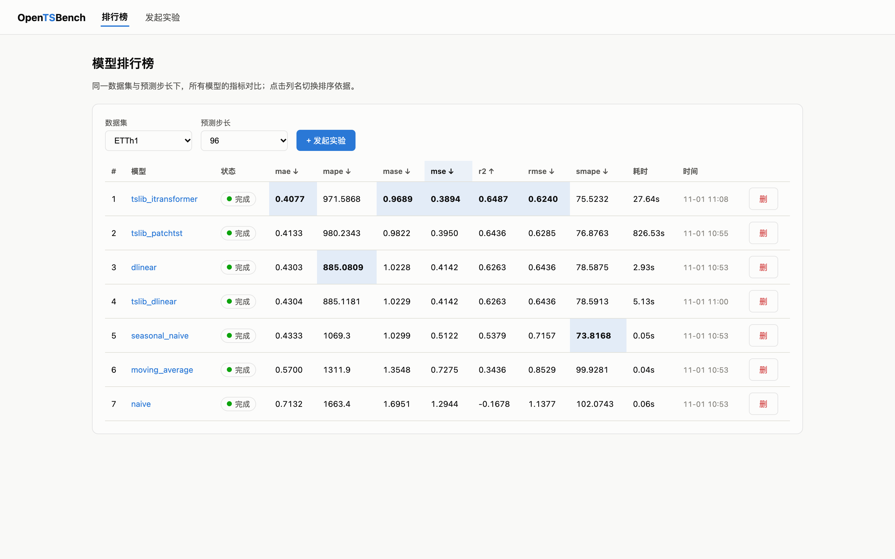
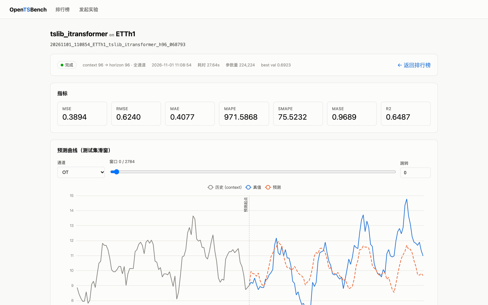
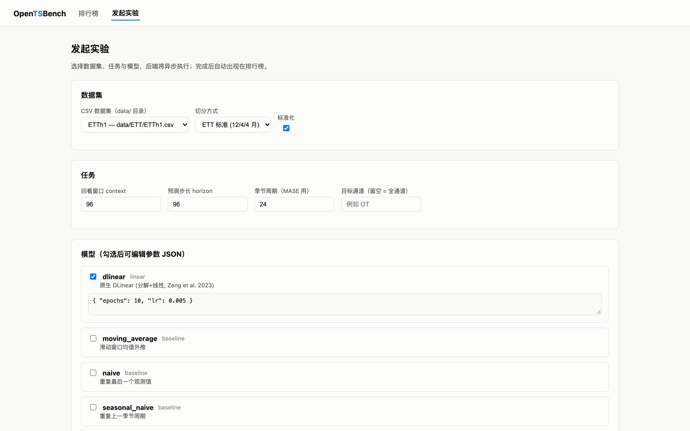

# OpenTSBench

高扩展、强解耦的开源时序预测模型评测平台。

**任意深度学习时序模型 × 任意开源数据集 × 多种评测指标 × Web 可视化** — 新增任何
数据集 / 模型 / 指标都只是"一个文件 + 一个装饰器"，不改框架核心代码。

架构设计详见 [docs/ARCHITECTURE.md](docs/ARCHITECTURE.md)。

## 界面预览

**排行榜** — 同口径多模型对比，每列最优自动高亮，点击列名切换排序（`?dataset=ETTh1&horizon=96` 可直达分享）：



**实验详情** — 7 项指标卡片 + 交互式预测曲线（灰线为模型可见的历史 context，蓝实线为真值，橙虚线为预测；可选窗口/通道，数值已反标准化回原始量纲）：



**发起实验** — 页面选数据集/任务参数/模型/指标，后台异步执行，完成后自动进入排行榜：



## 特性

- **插件化核心**：`@register_dataset` / `@register_model` / `@register_metric`
  三个注册表驱动全框架，CLI / API / 前端自动发现新插件。
- **统一评测口径**：所有模型面对完全相同的测试集滑窗（context 可回溯到 test 段之前，
  与 Time-Series-Library 等公开基准口径一致，窗口数逐点可比）。
- **第三方模型零侵入接入**：TSLib Adapter 通过 `sys.path` 注入 + 签名自适应包装
  （5 参 / 1 参 forward 自动识别）接入 `thuml/Time-Series-Library`，不修改其源码；
  同一机制接入 TimesFM 2.5、Chronos-2 等零样本基座模型，与有监督模型同口径对比。
- **指标体系**：MSE / RMSE / MAE / MAPE / sMAPE / MASE / R² / Pearson，指标自带方向元信息
  （前端据此排序与高亮）；“指标说明”页展示公式、计算步骤和标准化口径。
- **结果可复现**：每个 run 落盘 config.yaml + meta.json + metrics.json + data.npz。
- **Web 可视化**：排行榜（按指标排序、每列最优高亮、失败状态展示）、
  实验详情（指标卡片 + 交互式预测曲线：选窗口 / 选通道 / 反标准化回原始量纲）、
  从页面发起实验。

## 快速开始

```bash
# 1. 创建并激活虚拟环境（.venv，Python 3.10+）
python3 -m venv .venv
source .venv/bin/activate
pip install -r requirements.txt

# 2. 下载数据集（ETT 系列，约 25MB）
python3 cli.py download-data

# 3. 跑第一个实验（3 统计基线 + 开源 DLinear，CPU 约 1 分钟）
python3 cli.py run --config tsbench/configs/etth1_h96.yaml

# 4. 启动 API + 前端
python3 cli.py serve                 # API: http://127.0.0.1:8000
cd web && npm install && npm run dev # Web: http://localhost:5173
```

> 前端环境独立位于 `web/`（npm 管理的 node_modules），与 Python 虚拟环境互不影响。

## 日志

- 控制台：INFO 级别（实验进度、每模型耗时与指标摘要）。
- 文件：`logs/opentsbench.log`，DEBUG 级别全量（含每 epoch 的 train/val loss、
  早停、窗口生成、结果落盘），按天滚动、保留 14 天。
- 可用环境变量调整：`OPENTSB_LOG_DIR`（日志目录）、`OPENTSB_LOG_LEVEL`（文件级别）。

## CLI 一览

| 命令 | 说明 |
|---|---|
| `python3 cli.py run --config <yaml>` | 按配置运行实验（一个配置可含多个模型） |
| `python3 cli.py list [--dataset X]` | 列出实验结果表 |
| `python3 cli.py plugins` | 查看已注册插件 |
| `python3 cli.py serve [--port 8000]` | 启动 FastAPI |
| `python3 cli.py delete <run_id>` | 删除实验 |
| `python3 cli.py download-data` | 下载 ETT 数据集 |

## 接入新模型 / 数据集 / 指标

### 新模型（一行接入开源实现）

进程内适配器（依赖兼容时）— 见 [tsbench/models/tslib_adapter.py](tsbench/models/tslib_adapter.py)：

```python
# TSLib 系列一行注册:
_register("iTransformer", "...", {"d_model": 128})
# 其它 PyTorch 模型: 继承 TorchForecastModel（免费获得训练循环/早停/批量推理）
#   + build_network() 返回 (B,L,D)->(B,H,D) 的 nn.Module
```

依赖冲突的模型可走子进程适配器（预留扩展点，见架构文档 §7）。

### TimesFM 2.5（零样本预测）

```bash
git clone https://github.com/google-research/timesfm.git third_party/timesfm
python3 cli.py run --config tsbench/configs/etth1_timesfm.yaml
```

TimesFM 不在当前数据集上训练，`fit()` 仅加载预训练权重。首次运行会从 Hugging Face
下载 `google/timesfm-2.5-200m-pytorch`（约 200M 参数），之后使用本地缓存。
当前采用 Apache-2.0 的 2.5 版本；多通道数据按单变量逐通道推理，再恢复为统一输出形状。

### Chronos-2（零样本多变量预测）

```bash
git clone https://github.com/amazon-science/chronos-forecasting.git third_party/chronos-forecasting
python3 cli.py run --config tsbench/configs/etth1_chronos2.yaml
```

Chronos-2 同样不在评测数据集上训练，`fit()` 仅加载预训练权重。默认采用
`amazon/chronos-2`（120M 参数，权重文件约 478 MB），首次运行从 Hugging Face 下载。
它原生支持多变量预测，窗口内所有通道会联合推理。

### 新数据集

```python
@register_dataset("m4")
class M4Dataset(BaseDataset):
    def load(self) -> DatasetBundle: ...
```

### 新指标

```python
@register_metric("msis", higher_is_better=False)
def msis(y_true, y_pred, *, y_train=None, seasonal_period=1) -> float: ...
```

## 内置模型与结果示例

模型全部来自开源实现（通过 TSLib / TimesFM / Chronos-2 Adapter 零侵入接入）+ 统计基线。
ETTh1 · context=96 · horizon=96（CPU；TSLib 训练 10 epochs，基座模型为零样本，按 MSE 升序）：

| 模型 | MSE | MAE | MASE | R² | Pearson | 来源 |
|---|---|---|---|---|---|---|
| tslib_itransformer | **0.3894** | **0.4077** | 0.969 | 0.649 | **0.8071** | TSLib (ICLR 2024) |
| tslib_patchtst | 0.3950 | 0.4133 | 0.982 | 0.644 | 0.8023 | TSLib (ICLR 2023) |
| tslib_dlinear | 0.4142 | 0.4304 | 1.023 | 0.626 | 0.7917 | TSLib (AAAI 2023) |
| chronos2 | 0.4235 | 0.3970 | 0.944 | 0.618 | 0.7951 | Amazon Chronos-2 (120M) |
| timesfm | 0.4289 | 0.4024 | 0.957 | 0.613 | 0.7869 | Google TimesFM 2.5 (200M) |
| seasonal_naive | 0.5122 | 0.4333 | 1.030 | 0.538 | 0.7692 | 统计基线 |
| moving_average | 0.7275 | 0.5700 | 1.355 | 0.344 | 0.5938 | 统计基线 |
| naive | 1.2944 | 0.7132 | 1.695 | -0.168 | 0.4169 | 统计基线 |

TSLib 模型排序符合文献（iTransformer 论文 ETTh1-96 MSE 0.386，本框架 0.389）。
Chronos-2 与 TimesFM 未使用 ETTh1 训练，仅做零样本推理，指标仍与有监督模型处于同一量级，
说明同一套测试窗口和指标口径可以横向比较不同训练范式的模型。

## 目录结构

```
tsbench/                 # 核心 Python 包（core/datasets/models/metrics/evaluation/api）
web/                     # React + Vite + ECharts 前端
tsbench/configs/         # YAML 实验配置
scripts/download_data.py # 数据下载
docs/ARCHITECTURE.md     # 架构设计文档
```

## 已验证环境

- Python 3.12 · torch 2.15 (CPU) · FastAPI · pandas 3.0
- Node 25 · React 18 · Vite 5 · ECharts 5
- 数据：ETT (ETTh1/h2/m1/m2)；模型：`thuml/Time-Series-Library`、
  `google-research/timesfm`、`amazon-science/chronos-forecasting` @ third_party
